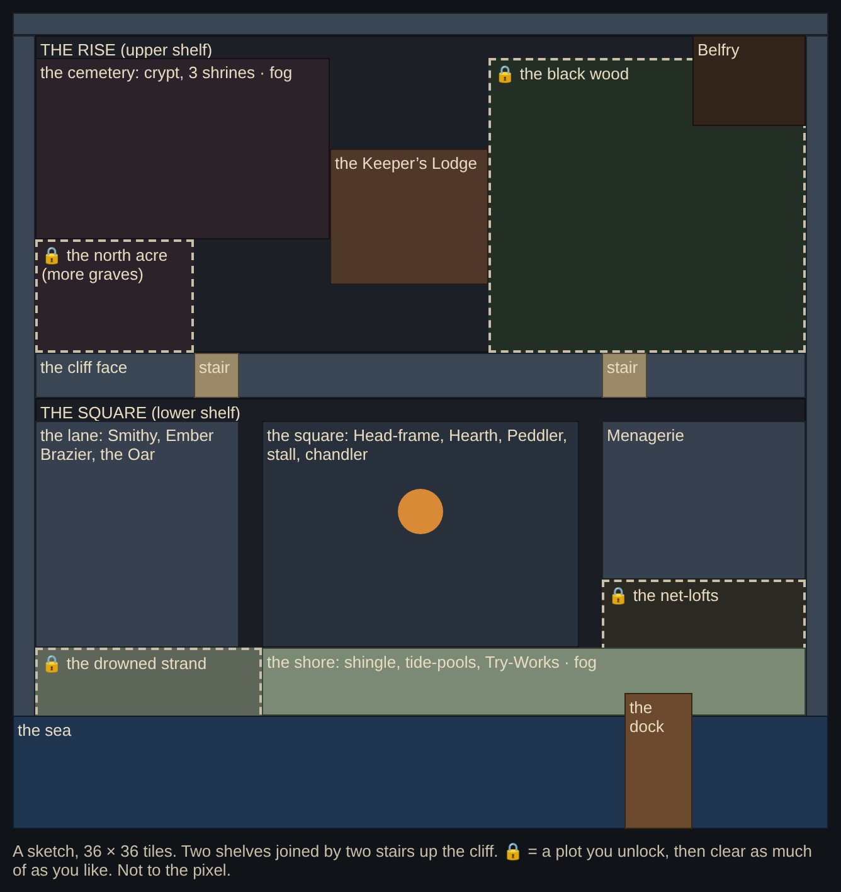

# Saltmouth, wider: two shelves

Status: **decided, nothing built** (Criss, Gemini and Claude on #154). Criss on #153: the square is getting crowded, so before step 9 the town grows. It gets more ground to build on, walk and explore, a bigger cemetery, buildings moved into quarters of their own, a shore you can walk, and fog. It stays small: smaller than an Animal Crossing island. The three map steps (§6) go into `EXPANSION4_RUNBOOK.md` in the first one's PR.

Everything in the runbook's §2 still holds. Pieces are decorations, pixel art comes from PixelLab (§3), everything is touch only, and it always rains. Developer mode never writes, and `ll-town` only grows.

---

## 1. Criss's calls (round 1, on #154)

1. **Two shelves.** Saltmouth climbs the cliff above the stair in two layers: the Rise above, the Square below, with a cliff face between them and stairs up it. It is a gentler version of Gemini's Terraced Shelf, which had three. Each shelf has room to build on.
2. **No lake. A dock instead.** It fits the story better, and it could matter at the end of the game.
3. **Fog along the shore and over the cemetery,** and nowhere else.
4. **Locked plots, cleared as you like.** A plot is locked until you unlock it. Once open, it is still overgrown, and you clear what you want, piece by piece. Nothing clears itself on unlocking, and nothing has to be cleared: growing the town is a cosmetic choice. Anything that already stands in a plot stays, and only a small path to it needs clearing.
5. **Gemini's points stand** where Criss did not change them:
   - about 36 tiles across;
   - the Lodge leaves the square, so the square is the Head-frame, the Hearth and the Peddler;
   - the outer quarters stay pitch black until you light them.

## 2. The layout

**36 × 36 tiles**, 2.25× today's 24 × 24. Each shelf is about 34 × 14, roughly the walkable ground of today's whole town, so there is about twice today's room to build. A folded Fold shows about 13 × 27 tiles, so the town is under three screens across and the climb from the shore to the cemetery is a short walk.

**The Rise (upper shelf):**
- **The cemetery,** about 13 × 8: the crypt and the three shrines. The fog lies here.
- **🔒 The north acre,** below it: ground for more headstones, behind a rusted gate.
- **The Keeper's Lodge,** alone on the Rise with a yard of its own. Its door and rooms are as they are.
- **🔒 The black wood,** the east half of the Rise: bent pines, deadfall and brambles round a clearing. It is pitch black until you light it.
- **The Cracked Belfry,** on the cliff's north-east corner.

**The cliff face** is two tiles of rock with **two stairs** up it, west and east. Anything on the Rise's edge stands against the sky above the cliff, so you see it from the Square as a silhouette.

**The Square (lower shelf):**
- **The square:** the Head-frame, the Hearth Beacon, the braziers, the Peddler's barrow, the Toothmonger's stall and the chandler's house. It is cramped and industrial.
- **The lane,** to the west: the Galvanic Smithy, the Ember Brazier and the Drowned Oar.
- **The Ossuary Menagerie,** to the east.
- **🔒 The net-lofts,** in the south-east: rotten nets, crates, a stove-in skiff.
- **The shore:** shingle you can walk along the whole south edge, the tide-pools and the Try-Works. The fog lies here.
- **🔒 The drowned strand,** the shore's west end: kelp wrack, a wreck's ribs, stones.
- **The dock,** a pier into the sea with a boat tied up, ruined until you restore it, like a workshop. What the boat is for waits for the true ending.

## 3. Plots: locked, then cleared as you like

- **A plot** is a named area (`TOWN_PLOTS`) with a gate, fence or barrier at its edge. It is locked, and you open it once with the haul (shape cost, like restoring a workshop). The Hearth Beacon's level could open one later; that is not decided.
- **What stands in it** is **debris**: fallen pines, stumps, brambles, rubble, nets, crates, wreckage, each one or two tiles. It is laid by hand, so every town's plot looks the same when it opens. Debris is solid. It stands until **you clear it**: a tap in Build, then a card saying what it is and what clearing it costs or gives back (shape; perhaps a little timber from a fallen pine).
- **Clear only what you like.** A plot can stay mostly overgrown forever. Pieces can be built only on cleared ground, so the paths you want are the ones you clear.
- **What was already there stays**: the Belfry in the wood's corner, the wreck's ribs on the strand. Only the debris on the way to it needs clearing.
- Saved as `ll-town.plots`: each plot's state (locked or open) and the debris cleared from it, by index, so a plot never re-grows.

## 4. Moving today's town

- **The square keeps your pieces.** Today's square goes onto the lower shelf as one block, moved by a single offset. Every saved piece in it moves with it in a one-time migration (`ll-town.v` 1 → 2). That covers paths, posts, benches, huts and where you stood.
- **What leaves the square** (the Lodge, the cemetery, the crypt and shrines, the Belfry, the Try-Works, the Menagerie, the tide-pools) goes to its new quarter. A piece that stood where something now goes **goes into Storage whole**, with a card that says so, rather than being paid back.
- Headstones you raised in the old cemetery move to the new one in the same order.
- Every place kept clear (`TOWN_KEEP`: stations, workplaces, hut doors, the Hearth's front, the Lodge's door) moves with its building.
- **Tests:** 16 test files name about 180 town tiles by number. M1 gives them a helper (`at(x, y)`, today's tile in the new map) rather than retyping every number.

## 5. Art, through PixelLab

- **The layout first, for free:** PixelLab maps are free to paint (`create_map`, `edit_map`, `view_map`) with tilesets we already own (G1's earth, E3's cobbles, the shells, the planks). We paint the two shelves there for Criss before anything is coded. `get_map` gives the cell grid, which becomes `TOWN_MAP`.
- **New ground and edges** (Wang sets, 16 px, our palette):
  - the cliff face and the Rise's edge;
  - shingle against earth and against the sea;
  - cemetery moss;
  - about 15 generations each.
- **New pieces, each on a contact sheet for Criss:**
  - the two stairs;
  - the dock and its boat, ruined and restored;
  - the plots' gates;
  - the debris;
  - more pines and dead trees.
- **Fog:** `vfx_workbench`'s `frost_mist` part ("low cold mist drifting sideways in dithered bands… graveyards, spooky"), which is free.
  - Its frames are baked once as a still and a loop, in the rain's colours, and laid over the shore and the cemetery after the dark at low strength.
  - The Hearth's circle thins it.
  - Full only; Lite and Reduce Motion show the still.
- **The outer dark:** a locked or unlit plot stays at full night, darker than the square (`TOWN_NIGHT` per area). Only what you build there lights it.

## 6. The steps (before step 9)

Each step is a middle-number bump, as the art passes were (Criss on #139). Step 9 becomes 19.16.0 and step 10 stays 20.0.0.

| Step | What | Version |
|---|---|---|
| **M1** | Two shelves: the 36 × 36 map, the cliff and its stairs, every building in its new place, the migration, the tests' helper. Plots are drawn but stay shut (no unlocking yet). The PixelLab layout goes to Criss first. | 19.13.0 |
| **M2** | Plots: their gates and unlocking, the debris and clearing it, `ll-town.plots`; the dock, restored like a workshop. | 19.14.0 |
| **M3** | Fog over the shore and the cemetery, the outer dark, small touches. | 19.15.0 |

**Prompt (M1):**
> Repo Sirfloppywaffle/the-last-lamp. Read AGENTS.md, CLAUDE.md, expansion/EXPANSION4_RUNBOOK.md (§2 to §4) and expansion/MAP_EXPANSION.md (all of it; §1 is Criss's calls). Build step M1, two shelves, following the runbook's §4 workflow. First paint the layout on a PixelLab map (free: create_map, edit_map, view_map, with the town's Wang tilesets) and show Criss before writing code. Then grow TOWN_MAP to 36 × 36, move today's square onto the lower shelf by one offset with a one-time ll-town migration (v 1 → 2: pieces in the square move with it; a piece displaced by a building goes into Storage whole), move the Lodge, the cemetery, the shrines, the Belfry, the Try-Works, the Menagerie and the tide-pools to their quarters, add the cliff and its two stairs, and give the tests a helper for today's tiles. Plots are drawn but stay shut. Add M1 to M3 to the runbook's status table and §5 (with this prompt and M2's) and shift step 9 to 19.16.0. Tick the status table. End with the prompt for M2.

## Round 0 (for the record)

Claude's first draft was a flat 48 × 40 island with a tarn, a copse and a lane round today's square. Gemini answered on #154:
- cut it to 36 × 30;
- move the Lodge out of the square;
- clear new ground with the haul;
- cut the tarn;
- fog only on the cemetery and shore;
- keep the outer quarters pitch black;
- or stack the town in three terraces, the Terraced Shelf.

Criss took two terraces and the rest as §1 says.
