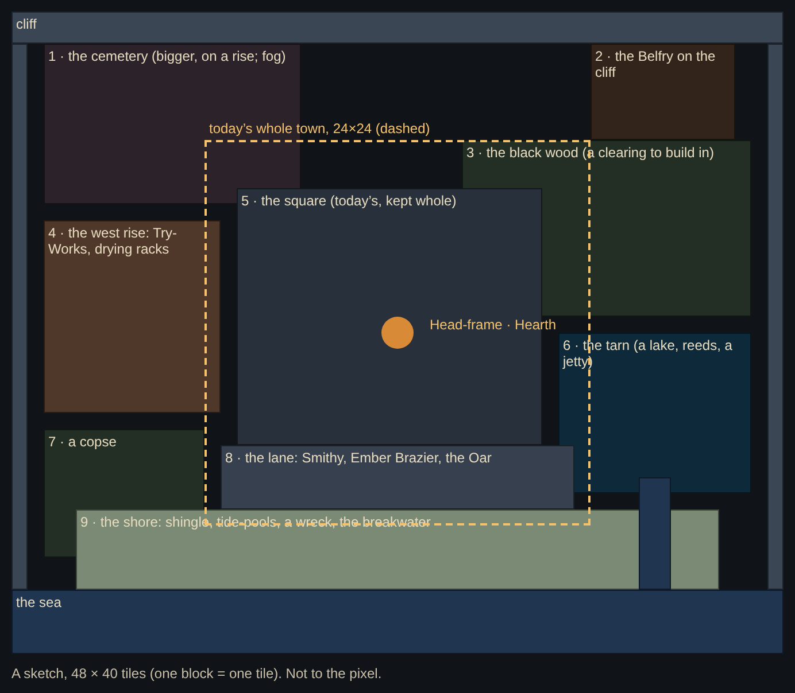

# Saltmouth, wider: a brainstorm

Status: **brainstorm, nothing built.** Criss on #153: the square is getting crowded, so before step 9 the town grows: more ground to build on, walk and explore, a bigger cemetery, buildings moved into their own quarters, small woods, a shore you can walk, maybe a lake, and fog. Not huge: a standard Animal Crossing island for scale, or smaller. Claude's opening draft for Gemini and Criss to argue over. Once Criss picks, this becomes steps in `EXPANSION4_RUNBOOK.md`.

Everything in the runbook's §2 still holds. Pieces are decorations. Pixel art comes from PixelLab (§3). Touch only. It always rains. Developer mode never writes. `ll-town` only grows.

---

## 1. Scale

Today the town is **24 × 24 tiles**, of which about 21 × 20 can be walked; the square is about 12 × 9 of that. A folded Fold shows about 13 × 27 tiles at once.

An Animal Crossing island is about 112 × 96 of its own tiles, with a character about one tile wide, like ours. "Smaller than that" suggests:

| Size | Area vs today | Screens across on a folded Fold | Feel |
|---|---|---|---|
| 40 × 32 | 2.2× | 3 | a village with a couple of corners to find |
| **48 × 40** (proposed) | **3.3×** | **3.7** | room for every quarter below, still a short walk end to end |
| 64 × 48 | 5.3× | 5 | an island; the walk starts to feel long by tap |

**Proposal: 48 × 40.** A tap walks anywhere in under 10 seconds at today's speed, and the ground canvas is 768 × 640 px, painted once. The dark, the rain and the glow are screen-sized and cost no more. Pathfinding is a BFS over 1,920 tiles, still nothing.

## 2. The layout

1. **The cemetery, on a rise in the north-west.** About 16 × 10 instead of 10 × 4, room for many more headstones. The crypt and the three shrines move up with it. The fog lies thickest here.
2. **The Cracked Belfry on the north-east cliff,** alone, where its bell carries.
3. **The black wood** in the east: bent pines and dead trees round a clearing you can build in. Fireflies, faintly, on Full.
4. **The west rise:** the Try-Works with its drying racks, over the sea wall.
5. **The square, kept whole** in the middle: the Head-frame, the Hearth, the braziers, the Lodge, the chandler, the Peddler's barrow, the Toothmonger's stall. It gets room to breathe once the workshops move out.
6. **The tarn**, a small black lake in the south-east. Reeds, a short jetty, a stream down to the sea under a plank bridge. Its water moves like the sea does (art pass A1) and the rain rings on it.
7. **A copse** in the south-west, small and dark.
8. **The lane**, south of the square: the Galvanic Smithy, the Ember Brazier and the Drowned Oar.
9. **The shore**, a strip of shingle and shells you can walk along the whole south edge. The tide-pools move here, beside a wreck and the breakwater. Keepers' huts would sit well up here.

The Ossuary Menagerie could go at the wood's edge or by the tarn.

## 3. What moves, and what that costs

There are two ways to grow, and they can be mixed:

- **A. Keep today's map whole, offset** (for example to (12, 8)) and grow round it. Every saved coordinate moves by the same amount in one migration (`ll-town.v` 1 → 2): built pieces, where you stood, huts. Nothing you built is lost or moved relative to the rest. The risk is low.
- **B. Relocate the buildings** into their quarters (above). Pieces that stood where a building now goes **go into Storage whole** (not paid back as today), with a card that says so.

**Proposal: A for the square, B for what leaves it.** The square stays where your town is, while the workshops, the cemetery and the tide-pools move out. Every place that must stay walkable (`TOWN_KEEP`, stations, hut doors, the Hearth's front) moves with its building.

The cost is in the tests: 16 test files name about 180 town tiles by number. The map step would give them a helper (`at(x, y)`, today's tile in the new map) rather than retype every number.

## 4. Art, through PixelLab

- **The layout first, for free.** PixelLab maps are free to paint (`create_map`, `edit_map`, `view_map`) with tilesets we already own: G1's earth, E3's cobbles, the shells, the planks. We sketch the island there and Criss looks at it before anything is coded. `get_map` gives the cell grid, which becomes `TOWN_MAP`, so the game keeps drawing it itself, as it does now.
- **New ground:** Wang sets at 16 px on our palette (`create_topdown_tileset`, pro mode, palette), each joined to G1's earth like the paths in step 7:
  - shingle and sand against earth, and against the sea;
  - tarn water against earth, with reeds at the edge;
  - cemetery moss against earth.
  - About 15 generations each.
- **New props:** pines and dead trees (more than A3's three), reeds, the jetty, the bridge, the wreck, the drying racks, a cliff edge. These are 1-direction jobs of 16 to 64 candidates, on contact sheets for Criss.
- **Fog:** `vfx_workbench` has a `frost_mist` part ("low cold mist drifting sideways in dithered bands… graveyards, spooky"), and it is free. We bake its frames as a still plus a loop, tinted to the rain's colours, and lay them after the dark at low strength. That puts thick fog over the cemetery and the tarn and a thin haze over the rest. The Hearth's circle thins it too, which ties it to the true ending. It is Full only, and still for Lite and Reduce Motion.
- **Smaller touches,** also free: `rain_ripples` on the tarn, `fireflies` in the wood, `smoke_column` from lit chimneys.

## 5. Exploring

Criss asked for areas to "build, walk around, explore". There are three ways to make the new ground worth walking to:

- **Open at once.** Everything is there from the first visit. This is the simplest.
- **Cleared with the haul** (proposed). A fallen pine across the wood path (timber), a broken plank bridge over the stream (iron), a cemetery gate rusted shut (iron and tallow). Each is a one-time tap and card, like restoring a workshop. That gives the four materials something new to buy without touching the stair.
- **Found.** A few things to tap that tell you something: a drowned bell in the tarn, a name on the wreck, a door in the cliff that does not open (yet). It's a cheap way to plant lore for the true ending.

## 6. Order

Before step 9 (Keepers react). Step 9's waypoints and lore chalk want the final map, and moving the Keepers' stations twice is wasted work. A draft:

- **M1, the bigger map:**
  - the migration, every quarter laid out in plain ground;
  - the buildings moved;
  - the tests' helper;
  - the PixelLab layout sketch for Criss first.
- **M2, the new ground and props from PixelLab:** shore, tarn, wood, cemetery, on contact sheets.
- **M3, fog and the small touches;** the things to clear and to find.

Each step is a middle-number bump, as the art passes were (Criss's call on #139), so step 9 and the versions after it shift.

## Open questions for Gemini and Criss

1. 48 × 40, or smaller (40 × 32)?
2. Does the layout put things in the right places? Should the Lodge stay in the square, or get a plot of its own on the west rise?
3. Should new ground open at once, or be cleared with the haul (§5)?
4. The tarn: worth it, or is the sea enough water?
5. Fog: everywhere a little, or only the cemetery and the tarn?
6. What could make a bigger town feel emptier rather than richer, and how do we keep it dense and eerie?
